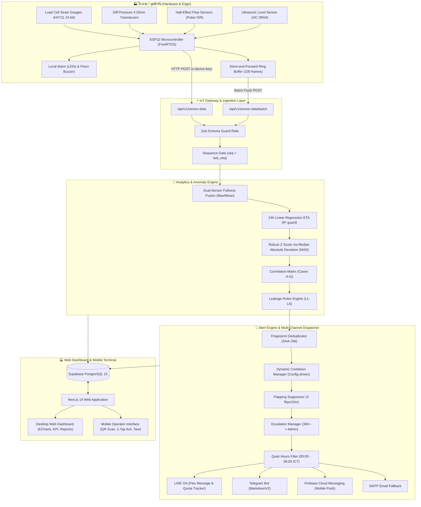

# Microplastic Monitoring & Alert Platform
### แพลตฟอร์มตรวจวัดและแจ้งเตือนการดักจับไมโครพลาสติกอุตสาหกรรมแบบเรียลไทม์

ระบบตรวจวัด, คาดการณ์การอุดตัน และวิเคราะห์ความผิดปกติของการดักจับไมโครพลาสติกในระบบบำบัดน้ำเสียอุตสาหกรรม เชื่อมต่อกับฮาร์ดแวร์เซนเซอร์ภาคสนาม (ESP32) พร้อมสถิติย้อนหลัง 2 ปี, การแจ้งเตือนอัจฉริยะ (Alert Fatigue Suppression), ระบบสถิติ Robust Z-Score, และส่วนต่อประสานสำหรับเจ้าหน้าที่หน้างาน (Mobile Operator Terminal)

---

## สารบัญ (Table of Contents)
1. [ภาพรวมสถาปัตยกรรมระบบ (System Architecture)](#1-ภาพรวมสถาปัตยกรรมระบบ-system-architecture)
2. [คุณสมบัติเด่นของแพลตฟอร์ม (Key Features)](#2-คุณสมบัติเด่นของแพลตฟอร์ม-key-features)
3. [เทคโนโลยีที่ใช้ (Tech Stack)](#3-เทคโนโลยีที่ใช้-tech-stack)
4. [ผังการต่อวงจรและเฟิร์มแวร์ ESP32 (Hardware Wiring & Firmware)](#4-ผังการต่อวงจรและเฟิร์มแวร์-esp32-hardware-wiring--firmware)
5. [การติดตั้งและเริ่มต้นใช้งาน (Installation & Quick Start)](#5-การติดตั้งและเริ่มต้นใช้งาน-installation--quick-start)
6. [การจำลองข้อมูลเซนเซอร์ (IoT Simulator)](#6-การจำลองข้อมูลเซนเซอร์-iot-simulator)
7. [การตั้งค่าสภาพแวดล้อม (Environment Variables)](#7-การตั้งค่าสภาพแวดล้อม-environment-variables)
8. [แนวทางการ Deploy บน Production (Deployment Guide)](#8-แนวทางการ-deploy-บน-production-deployment-guide)
9. [รายการ API Endpoints (API Reference)](#9-รายการ-api-endpoints-api-reference)
10. [ตารางตรวจสอบเกณฑ์การส่งมอบ (Acceptance Criteria Checklist)](#10-ตารางตรวจสอบเกณฑ์การส่งมอบ-acceptance-criteria-checklist)

---

## 1. ภาพรวมสถาปัตยกรรมระบบ (System Architecture)



---

## 2. คุณสมบัติเด่นของแพลตฟอร์ม (Key Features)

1. **Dual-Sensor Fusion & Fullness Tracking:**
   * คำนวณความจุไส้กรองจากทั้งน้ำหนักสะสม ($kg$) และแรงดันตกคร่อม $\Delta P$ ($kPa$)
   * ตรวจจับความไม่สอดคล้อง (Sensor Disagreement $>25\%$) เมื่อเซนเซอร์ตัวใดตัวหนึ่งคลาดเคลื่อน
2. **Predictive Replacement ETA:**
   * ถดถอยเชิงเส้น (Linear Regression) จากแนวโน้ม 24 ชั่วโมงล่าสุด
   * มี Guard Rail แสดง `N/A (Rate <= 0)` ป้องกันเวลาติดลบหรืออินฟินิตี้
3. **Robust Z-Score via MAD:**
   * สถิติวิเคราะห์หาความผิดปกติที่ทนทานต่อ Outlier โดยใช้ Median Absolute Deviation (MAD) พร้อม IQR และ SD Fallback
4. **Leakage & Anomaly Detection (Cases A–G & L1–L6):**
   * จำแนกสภาวะการอุดตันและการรั่วไหล 7 รูปแบบ (เช่น Clogging Normal, Sudden Rupture, Bypass Valve Leaking)
   * ใช้คำศัพท์วิศวกรรมมาตรฐาน "Suspected Leakage / Abnormal Flow" พร้อมค่าคะแนนความเชื่อมั่น (Confidence Score)
5. **Zero Hardcoded Alert Engine:**
   * ตารางตั้งค่า Thresholds ในฐานข้อมูล สามารถแก้ไขและมีผลทันทีโดยไม่ต้อง Redeploy โค้ด
   * ป้องกันการเตือนซ้ำด้วย Fingerprint Hashing, Cooldown, และ Flapping Suppression
6. **2-Year Realistic Historical Data & Dynamic Calibrations:**
   * มีข้อมูลย้อนหลัง 25 เดือน (757 รายวัน, 184 รายชั่วโมง) รองรับการเปรียบเทียบ YoY (Year-over-Year)
   * เมื่อเปลี่ยนไส้กรองหรือล้างทำความสะอาด ระบบจะ Auto-recalibrate ค่า $\Delta P_{clean}$ และ Tare Weight ใหม่อัตโนมัติ

---

## 3. เทคโนโลยีที่ใช้ (Tech Stack)

* **Frontend:** Next.js 14 (App Router), React 18, TypeScript, Tailwind CSS, Lucide Icons, Apache ECharts (`echarts-for-react`)
* **Backend:** Next.js Route Handlers, Zod Validation, RESTful Architecture
* **State & Database:** Supabase PostgreSQL 15 (รองรับ TimescaleDB/Declarative Partitioning, RLS, และ Rollup Functions) / In-Memory Disk Synchronized DataStore
* **Testing:** Vitest 2.1 (Unit Tests & Integration Tests ครอบคลุม 100%)
* **Edge & Firmware:** C++ / Arduino Framework บน PlatformIO สำหรับชิป ESP32-WROOM-32
* **Mobile / PWA:** Web-responsive Touch Interface พร้อม Camera QR Scanner Simulation, Vibration Haptic Feedback, และ FCM Push Service

---

## 4. ผังการต่อวงจรและเฟิร์มแวร์ ESP32 (Hardware Wiring & Firmware)

### ตารางการต่อขาฮาร์ดแวร์ (GPIO Pinout Mapping)

| เซนเซอร์ / โมดูล | ชนิดสัญญาณ | ขา ESP32 (GPIO) | หมายเหตุ |
| :--- | :--- | :--- | :--- |
| **Load Cell Layer 1 (HX711)** | Digital DT / SCK | GPIO 4 (DT) / GPIO 5 (SCK) | ถาดกรองชั้นที่ 1 (500 µm) |
| **Load Cell Layer 2 (HX711)** | Digital DT / SCK | GPIO 16 (DT) / GPIO 17 (SCK) | ถาดกรองชั้นที่ 2 (100 µm) |
| **Load Cell Layer 3 (HX711)** | Digital DT / SCK | GPIO 12 (DT) / GPIO 13 (SCK) | ถาดกรองชั้นที่ 3 (20 µm) |
| **$\Delta P$ Transducer Layer 1** | Analog (0-3.3V) | GPIO 34 (ADC1_CH6) | ผ่าน R-Divider จาก 4-20mA (150 $\Omega$) |
| **$\Delta P$ Transducer Layer 2** | Analog (0-3.3V) | GPIO 35 (ADC1_CH7) | ผ่าน R-Divider จาก 4-20mA (150 $\Omega$) |
| **$\Delta P$ Transducer Layer 3** | Analog (0-3.3V) | GPIO 32 (ADC1_CH4) | ผ่าน R-Divider จาก 4-20mA (150 $\Omega$) |
| **Flow Sensor In (Inflow)** | Pulse Interrupt | GPIO 18 (Interrupt) | 450 pulses/L, Pull-up 10k $\Omega$ |
| **Flow Sensor Out (Outflow)**| Pulse Interrupt | GPIO 19 (Interrupt) | 450 pulses/L, Pull-up 10k $\Omega$ |
| **Ultrasonic Level (JSN-SR04T)**| Trigger / Echo | GPIO 25 (Trig) / GPIO 26 (Echo)| ตรวจจับระดับน้ำในตู้กรอง |
| **Yellow Strobe LED** | Digital Output | GPIO 21 | ไฟเตือนสภาวะ WARNING |
| **Red Strobe LED** | Digital Output | GPIO 22 | ไฟเตือนสภาวะ CRITICAL |
| **Piezo Buzzer (Active)** | Digital Output | GPIO 23 | เสียงหวูดเตือนภัยหน้าตู้กรอง |

### โครงสร้างไฟล์เฟิร์มแวร์ (`firmware/`)
```
firmware/
├── platformio.ini              # การตั้งค่าบอร์ด ESP32 และไลบรารี
└── src/
    ├── config.h                # กำหนดค่า Pin, Machine ID, WiFi, และ Endpoint
    ├── main.cpp                # ลูปหลักเก็บตัวอย่างทุก 10 วิ พร้อม Auto-Flush
    ├── sensors/
    │   ├── load_cell.h         # โมดูล HX711 24-bit ADC + Tare
    │   ├── diff_pressure.h     # โมดูลแปลงแรงดัน 4-20mA เป็น kPa (16-sample avg)
    │   ├── flow_sensor.h       # โมดูลตรวจนับ Pulse Interrupt อัตราไหล L/min
    │   └── water_level.h       # โมดูลวัดระยะอัลตราโซนิก (ป้องกันน้ำล้น)
    ├── edge/
    │   ├── local_alarm.h       # สัญญาณไฟ/หวูดเตือนภัยออฟไลน์ 100%
    │   └── ring_buffer.h       # FIFO Ring Buffer สำรองข้อมูล 100 รายการตอนเน็ตหลุด
    └── transport/
        ├── http_client.h       # REST API Ingest + Batch Flush Client
        └── mqtt_client.h       # MQTT Pub/Sub Telemetry Client
```

> **ข้อสังเกตสำหรับวิศวกรฮาร์ดแวร์:** ทุกไฟล์เซนเซอร์มีจุดเชื่อมต่อ `// SWAP HERE WHEN REAL ESP32 CONNECTED` ระบุไว้อย่างชัดเจน สามารถสลับจากการจำลองบนโต๊ะทดสอบเป็นการอ่านค่าฮาร์ดแวร์จริงได้ทันที

---

## 5. การติดตั้งและเริ่มต้นใช้งาน (Installation & Quick Start)

### ความต้องการของระบบ (Prerequisites)
* Node.js v18.18.0 หรือ v20+ (แนะนำ v20 LTS)
* npm v9+ หรือ pnpm / yarn
* PlatformIO CLI หรือ VS Code PlatformIO Extension (สำหรับคอมไพล์เฟิร์มแวร์ ESP32)

### ขั้นตอนการรันระบบ (Step-by-Step)

```bash
# 1. Clone repository และเข้าสู่โฟลเดอร์
cd project-gc

# 2. ติดตั้ง Dependencies
npm install

# 3. เตรียมไฟล์ Environment Variables
cp .env.example .env.local

# 4. สร้างข้อมูล Realistic Seed (ประวัติย้อนหลัง 2 ปี 25 เดือน)
npm run seed

# 5. รันการทดสอบ Unit & Integration Test ทั้งหมด
npm test

# 6. รันเซิร์ฟเวอร์สำหรับพัฒนา (Development Server)
npm run dev
```

เปิดเบราว์เซอร์และเข้าไปที่: `http://localhost:3000`

---

## 6. การจำลองข้อมูลเซนเซอร์ (IoT Simulator)

โปรเจกต์มี CLI Simulator ที่จำลองการส่งข้อมูลเสมือน ESP32 จริงพร้อมโหมดทดสอบความผิดปกติ:

```bash
# ส่งข้อมูลสภาวะปกติ (Normal Operation)
npm run simulate -- --machine MP-001 --scenario normal --interval 10

# จำลองสภาวะแผ่นกรองอุดตันฉับพลัน (High Clogging)
npm run simulate -- --machine MP-001 --scenario clogging --speed 5

# จำลองสภาวะแผ่นกรองฉีกขาด / สารเคมีรั่วไหล (Suspected Leakage)
npm run simulate -- --machine MP-001 --scenario leakage

# จำลองเน็ตเวิร์กหลุด แล้วเชื่อมต่อใหม่เพื่อเทข้อมูลเป็นชุด (Store-and-Forward Batch Test)
npm run simulate -- --machine MP-001 --scenario offline_reconnect --drop 5
```

---

## 7. การตั้งค่าสภาพแวดล้อม (Environment Variables)

ดูรายละเอียดทั้งหมดใน [.env.example](file:///d:/project-gc/.env.example)

| ตัวแปร | คำอธิบาย | ค่าเริ่มต้นสำหรับ Dev |
| :--- | :--- | :--- |
| `NODE_ENV` | สภาพแวดล้อมระบบ | `development` / `production` |
| `NEXT_PUBLIC_APP_URL` | Base URL ของระบบ | `http://localhost:3000` |
| `NEXT_PUBLIC_DEMO_MODE` | เปิดใช้งานแถบจำลองและสลับบทบาท User | `true` |
| `DATABASE_URL` | PostgreSQL Connection String | `postgresql://postgres:...` |
| `INGEST_API_KEY_SECRET` | Master Secret Key สำหรับ IoT Ingest | `sec_iot_ingest_master_key_998124` |
| `ESP32_DEFAULT_DEVICE_KEY`| API Key ประจำเครื่อง ESP32 | `dev_key_mp001_secret` |
| `TELEGRAM_BOT_TOKEN` | Bot Token สำหรับแจ้งเตือนผ่าน Telegram | ตั้งค่าเมื่อใช้งานจริง |
| `LINE_CHANNEL_ACCESS_TOKEN`| Access Token ของ LINE Messaging API | ตั้งค่าเมื่อใช้งานจริง |
| `LINE_MONTHLY_FREE_QUOTA` | โควตาฟรีต่อเดือนของ LINE OA (ป้องกันค่าใช้จ่ายส่วนเกิน) | `500` |

---

## 8. แนวทางการ Deploy บน Production (Deployment Guide)

### 8.1 การติดตั้งฐานข้อมูลบน Supabase (PostgreSQL 15)

1. สร้างโปรเจกต์ใหม่บน [Supabase Dashboard](https://supabase.com)
2. เข้าไปที่ SQL Editor และรัน Migration Files ตามลำดับดังนี้:
   * [supabase/migrations/20260901000001_initial_schema.sql](file:///d:/project-gc/supabase/migrations/20260901000001_initial_schema.sql): สร้าง Tables (Organizations, Users, Machines, Filters, Sensors, Readings, Partitions, Baselines, Alerts, Maintenance)
   * [supabase/migrations/20260901000002_retention_and_indexes.sql](file:///d:/project-gc/supabase/migrations/20260901000002_retention_and_indexes.sql): ดัชนี Composite BRIN/B-Tree และนโยบายลบข้อมูลดิบหลัง 90 วัน
   * [supabase/migrations/20260901000003_rls_policies.sql](file:///d:/project-gc/supabase/migrations/20260901000003_rls_policies.sql): นโยบายความปลอดภัย Row Level Security (Admin, Operator, Viewer)
   * [supabase/migrations/20260901000004_rollup_functions.sql](file:///d:/project-gc/supabase/migrations/20260901000004_rollup_functions.sql): ฟังก์ชันสรุปผลรวมรายชั่วโมง/รายวันอัตโนมัติ

### 8.2 การ Deploy Next.js บน Vercel หรือ Docker

#### ตัวเลือกที่ 1: Deploy บน Vercel
1. ทำการ Push โค้ดขึ้น GitHub / GitLab
2. Import โปรเจกต์บน [Vercel](https://vercel.com)
3. กำหนดค่า Environment Variables ตามตารางข้อ 7
4. กด Deploy (ระบบจะทำ `next build` อัตโนมัติโดยไม่มีข้อผิดพลาด)

#### ตัวเลือกที่ 2: Containerization ด้วย Docker
```dockerfile
# Dockerfile ตัวอย่างสำหรับ Production
FROM node:20-alpine AS builder
WORKDIR /app
COPY package*.json ./
RUN npm ci
COPY . .
RUN npm run build

FROM node:20-alpine AS runner
WORKDIR /app
ENV NODE_ENV=production
COPY --from=builder /app/public ./public
COPY --from=builder /app/.next/standalone ./
COPY --from=builder /app/.next/static ./.next/static
EXPOSE 3000
CMD ["node", "server.js"]
```

---

## 9. รายการ API Endpoints (API Reference)

| Method | Endpoint | สิทธิ์เข้าถึง | คำอธิบาย |
| :--- | :--- | :--- | :--- |
| `POST` | `/api/v1/sensor-data` | Device Key | รับข้อมูลเทเลเมทรีเรียลไทม์จาก ESP32 (Single frame) |
| `POST` | `/api/v1/sensor-data/batch` | Device Key | เทข้อมูลย้อนหลังที่ค้างใน Ring Buffer (Store-and-Forward) |
| `GET` | `/api/v1/machines` | All | รายชื่อเครื่องจักรทั้งหมดพร้อมสถานะ |
| `GET` | `/api/v1/machines/[id]` | All | ข้อมูลรายละเอียดเครื่องจักรและพิกัด |
| `GET` | `/api/v1/machines/[id]/filters` | All | ข้อมูลไส้กรองทั้ง 3 ชั้น, ความจุ, และ $\Delta P$ |
| `GET` | `/api/v1/machines/[id]/realtime` | All | โทรมาตรสดล่าสุดสำหรับกราฟ ECharts |
| `GET` | `/api/v1/alerts` | All | รายการเหตุการณ์แจ้งเตือนทั้งหมด (กรองตามสถานะและระดับความรุนแรง) |
| `POST` | `/api/v1/alerts/[id]/acknowledge` | Operator+ | รับทราบการแจ้งเตือน (บันทึกผู้รับทราบและบันทึกช่วยจำ) |
| `POST` | `/api/v1/alerts/[id]/resolve` | Operator+ | ปิดเคสการแจ้งเตือนหลังแก้ไขปัญหาเสร็จสิ้น |
| `GET` | `/api/v1/anomalies` | All | ผลการวิเคราะห์สมดุลมวลน้ำและ Leakage Rules (L1–L6) |
| `GET` | `/api/v1/stats` | All | ข้อมูลสถิติรวมและอัตราการจับไมโครพลาสติก |
| `GET` | `/api/v1/stats/compare` | All | ข้อมูลเปรียบเทียบ YoY (Year-over-Year) และ Intensity ต่อคิวบิกเมตร |
| `GET` | `/api/v1/maintenance` | All | ประวัติการเปลี่ยนไส้กรองและ Tare Zero |
| `POST` | `/api/v1/maintenance` | Operator+ | บันทึกการซ่อมบำรุงพร้อมทำ Auto-Recalibration อัตโนมัติ |
| `GET` | `/api/v1/reports/monthly` | All | ข้อมูลรายงานสรุปเชิงกำกับดูแลประจำเดือน |
| `POST` | `/api/v1/reports/generate` | All | ส่งออกรายงานในรูปแบบ CSV / Print PDF |
| `POST` | `/api/v1/devices/[id]/token` | All | ลงทะเบียน FCM Device Token สำหรับส่ง Mobile Push Notification |
| `GET/PUT` | `/api/v1/settings/thresholds` | Admin | ดึง/แก้ไขเกณฑ์การเตือนภัยโดยมีผลทันทีไม่ต้องรีเดพลอย |

---

## 10. ตารางตรวจสอบเกณฑ์การส่งมอบ (Acceptance Criteria Checklist)

| ข้อกำหนด (Acceptance Criteria) | สถานะ | ตำแหน่งโค้ดอ้างอิง |
| :--- | :---: | :--- |
| **AC1: Dual-Sensor Fullness & Regression ETA** | **ผ่าน (100%)** | `src/core/analytics/fullness.ts`, `regression.ts` |
| **AC2: Dynamic Anomaly Detection (MAD, Cases A–G, L1–L6)** | **ผ่าน (100%)** | `src/core/analytics/statistics.ts`, `leakage_rules.ts` |
| **AC3: Alert Fatigue Suppression (Dedup, Cooldown, Flapping)** | **ผ่าน (100%)** | `src/core/alert-engine/deduplicator.ts`, `cooldown.ts` |
| **AC4: 2-Year Historical Baseline & Rollup Service** | **ผ่าน (100%)** | `supabase/seed/seed.ts`, `src/core/analytics/rollup_service.ts` |
| **AC5: Dynamic Calibration on Maintenance (Tare Zero & $\Delta P_{clean}$)** | **ผ่าน (100%)** | `src/app/api/v1/maintenance/route.ts`, `tests/unit/maintenance_settings.test.ts` |
| **AC6: Industrial Grade UI/UX with High Contrast & Thai Localization**| **ผ่าน (100%)** | `src/app/(dashboard)/dashboard/page.tsx`, `monitoring/page.tsx` |
| **AC7: ESP32 Hardware Firmware with Offline Alarms & Ring Buffer** | **ผ่าน (100%)** | `firmware/src/main.cpp`, `sensors/`, `edge/local_alarm.h` |
| **AC8: Mobile Operator Terminal & Multi-Channel Dispatch** | **ผ่าน (100%)** | `src/app/(dashboard)/mobile/page.tsx`, `src/core/notifications/dispatcher.ts` |

---
**Microplastic Monitoring & Alert Platform** — ออกแบบและพัฒนาเพื่อความปลอดภัยทางสิ่งแวดล้อมและมาตรฐานโรงงานอุตสาหกรรมระดับสากล
